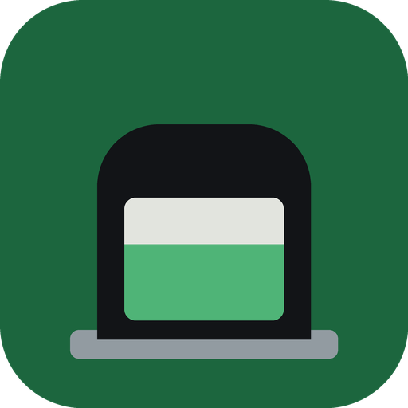

# Groningen container vulgraad for Home Assistant



[](https://github.com/WouterJN/homeassistant-groningen-vulgraad/actions/workflows/validate.yml)
[](https://github.com/WouterJN/homeassistant-groningen-vulgraad/actions/workflows/tests.yml)
[](https://github.com/WouterJN/homeassistant-groningen-vulgraad/actions/workflows/latest.yml)

See how full the underground waste containers (*ondergrondse containers*) in
the municipality of Groningen are: restafval, papier, glas, plastic and
textiel. The
municipality only shows the fill levels (*vulgraad*) inside its
burgerportaal, which has no public API. This integration reads the portal for
you and turns your containers into ordinary sensors.

No account is needed, and one poll covers every container you follow.

## What you get

Per container, grouped under a device for its cluster:

- A **fill level** sensor, in percent, with a `status` attribute that is `ok`,
  `warn` or `alarm`. The thresholds behind it come from the portal and differ
  per container, so automations never need to hardcode 60 and 80.
- A **last emptied** sensor, a timestamp; see [Last emptied](#last-emptied).

| Attribute of the fill level | Meaning |
| --- | --- |
| `status` | `ok`, `warn` or `alarm` |
| `warn_threshold`, `alarm_threshold` | The levels at which the portal warns |
| `fraction` | What the container is for, as the portal reports it |
| `cluster_name`, `cluster_id`, `container_number` | Where it is, and which one |

A container without a working fill sensor, or a poll that fails, shows as
**unavailable**, never as 0. A 0 would look like an emptying and fire exactly
the automation you did not want.

Home Assistant shows all of this in English or Dutch.

### An automation

Get a message when a container is almost full:

```yaml
triggers:
  - trigger: state
    entity_id: sensor.1234_teststraat_restafval_111
    attribute: status
    to: alarm
actions:
  - action: notify.notify
    data:
      message: "The restafval container is almost full."
```

Replace the entity ID with your own; it is made of the cluster, the fraction
and the container number.

## Last emptied

The portal does not say when a container was emptied, so this is inferred:
when the fill level falls by at least 20 points between two polls, the time of
that poll is recorded.

- It is accurate to within one poll interval.
- It reads `unknown` until the first emptying has been seen.
- The last level it saw is kept when Home Assistant restarts, so an emptying
  while Home Assistant was off is still caught.

## Installation

[](https://my.home-assistant.io/redirect/hacs_repository/?owner=WouterJN&repository=homeassistant-groningen-vulgraad&category=integration)

Requires Home Assistant 2024.11 or newer.

### Marketplace (recommended)

From Home Assistant 2026.11:

1. Go to **Settings** > **Marketplace**.
2. Search for **Groningen container vulgraad** and open it.
3. Select **Install**, and **Install** again in the dialog.

If Home Assistant asks for a restart, restart it. Then continue with
[Setup](#setup).

The button above opens the integration in the Marketplace of your own Home
Assistant directly.

### HACS (Home Assistant before 2026.11)

In HACS, search for **Groningen container vulgraad**, install it and restart
Home Assistant. When you update to Home Assistant 2026.11 or later, the
Marketplace takes over the installation by itself, and you keep receiving
updates.

### Other ways

- **Add from link**: if the Marketplace does not list the integration yet, go
  to **Settings** > **Marketplace**, select **Add from link** and enter
  `https://github.com/WouterJN/homeassistant-groningen-vulgraad`. The
  Marketplace asks you to connect GitHub for this. In HACS this is **Custom
  repositories** in the menu (⋮), with type **Integration**.
- **Manual**: copy `custom_components/groningen_vulgraad` to the
  `custom_components` folder in your Home Assistant configuration folder and
  restart Home Assistant. You then have to install updates yourself.

## Setup

1. Go to **Settings → Devices & services → Add integration → Groningen
   container vulgraad**.
2. Enter any postcode and house number in the municipality of Groningen. The
   address only unlocks the portal and filters nothing, so a public building
   works as well as your own.
3. Pick your containers. The list holds every container with a fill sensor,
   nearest to your Home Assistant location first.
4. Choose how often to poll. Once an hour is the default, and the minimum.

### Following more containers

Open the integration under **Settings → Devices & services → Groningen
container vulgraad** and choose **Configure**. Add or remove containers in the
list and submit. Sensors of containers you remove are removed too.

Do not add the integration a second time: one entry follows any number of
containers, because a single poll returns the whole municipality.

## Troubleshooting

- **A fill level is unavailable**: the container has no working fill sensor,
  or the last poll failed. A failed poll is retried at the next interval.
- **A repair says the portal has been redeployed**: when the municipality
  rebuilds the portal, the integration normally finds its way again by itself,
  within the same poll. The repair appears only when that fails. Look under
  **Settings → Updates** for a new version, and otherwise open an issue.
- **Reporting a problem**: open the integration under **Settings → Devices &
  services → Groningen container vulgraad**, choose **Download diagnostics**
  from the menu (⋮) and attach the file to your
  [issue](https://github.com/WouterJN/homeassistant-groningen-vulgraad/issues).
  It leaves out your address, and the numbers and locations of the containers
  you follow.
- **Debug logging**: add this to `configuration.yaml`:

  ```yaml
  logger:
    logs:
      custom_components.groningen_vulgraad: debug
  ```

## How it works

The burgerportaal is a Mendix app. The integration walks the same steps the
website does, and receives every container in the municipality in one go. That
is why following ten containers costs the same as following one, and why
polling more often than hourly is discouraged: the portal builds a large
payload every time.

Every request to the portal names internal identifiers that change whenever
the portal is rebuilt. When the stored ones stop working, the integration
reads the new ones from the portal's own page definitions and remembers them.

When the portal cannot be reached during setup, the container list falls back
to the municipality's open data service (`maps.groningen.nl/geoserver`) for
names and locations. That service has no fill levels, so it never replaces
the portal.

## Development

```bash
python3.14 -m venv .venv
source .venv/bin/activate
pip install -r requirements-dev.txt
pytest
ruff check .
```

`requirements-dev.txt` pins the test framework, and with it the Home Assistant
version the tests run against. Once a week the tests also run against the
newest Home Assistant. When that fails, fix what broke and raise the pin.

`api.py` holds the portal client and has no Home Assistant dependencies.
Changes are listed in [CHANGELOG.md](CHANGELOG.md).

## License

[MIT](LICENSE)
